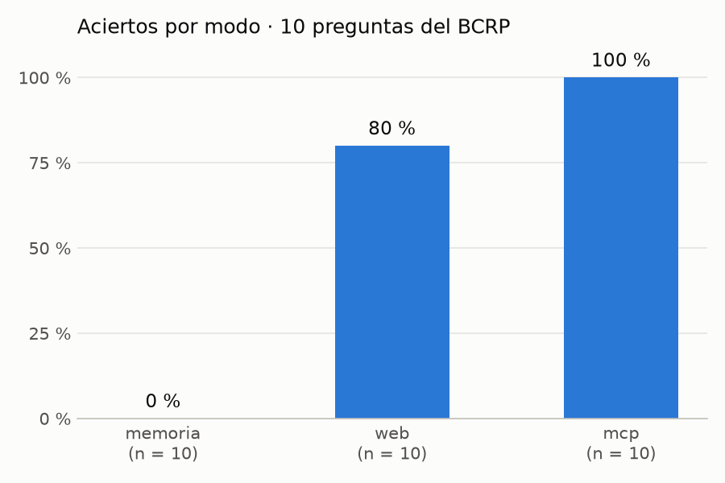

# ¿Inventa cifras Claude? Memoria, búsqueda web y MCP del BCRP

Evaluación con `evaluar.py`: 10 preguntas sobre cifras oficiales del BCRP (`preguntas.csv`), cada una hecha a Claude Haiku (`claude -p`) en tres modos:

- **memoria**: sin herramientas.
- **web**: con WebSearch y WebFetch.
- **mcp**: con el servidor `bcrp` de este proyecto (`server.py`).

Una respuesta acierta si queda dentro de la tolerancia de la pregunta. Si el modelo responde `null`, cuenta como "no sé". Los resultados están en `resultados.csv`.

## 1. Resultados por modo

| Modo | Aciertos | Errores | "No sé" | Segundos promedio |
|---|---|---|---|---|
| memoria | 0 | 0 | 10 | 5.8 |
| web | 8 | 1 | 1 | 21.8 |
| mcp | 10 | 0 | 0 | 12.3 |

## 2. Preguntas falladas y por qué

**memoria (10 "no sé")**: Haiku no respondió ninguna pregunta, pero tampoco inventó cifras. En la columna `fuente` explica que no tiene acceso al BCRP ni al INEI y que no conoce la cifra con certeza, por ejemplo: *"no conozco con certeza la cifra de setiembre de 2026 (mi conocimiento llega hasta junio de 2026)"*. Casi todas las preguntas son de 2025–2026, así que el modelo no puede saberlas de memoria.

**web (1 "no sé", 1 error)**

- `referencia_set26`, "no sé": solo encontró una nota de Peru Retail del 14 de agosto de 2026, que anuncia la sesión de política monetaria del 10 de setiembre sin dar la decisión. Detectó que un resumen de búsqueda le atribuía a esa nota una decisión que no aparece en el texto. Como no pudo confirmar el 4.25 % para setiembre, no lo dio.
- `cobre_ago26`, error: el problema está en la pregunta, no en el modelo. Respondió **651**, que es la cotización LME del cobre (PN01652XM, 2026-08: 651.45 ¢US$/lb), y la tomó de la página de estadísticas del BCRP. La `verdad` del CSV, en cambio, es **689.70**: el precio de **exportación** del cobre peruano (PN38784BM). Las dos son series oficiales del BCRP, y la pregunta ("precio promedio del cobre… según el BCRP") no dice cuál de las dos pide. Además, la pregunta del oro sí usa la cotización LME (PN01654XM), así que la del cobre no sigue el mismo criterio. Si se precisa la serie en el enunciado, lo esperable es que web llegue a 9 aciertos.

**mcp (ninguna)**: acertó las 10. En la del oro, Haiku usó la serie diaria PD04704XD y calculó el promedio de agosto (4411.15), que coincide con la serie mensual PN01654XM.

## 3. Gráfico

Generado con `uv run grafico.py` a partir de `resultados.csv`.

## 4. Cifras comprobadas a mano

| Dato | Valor | Serie | Periodo | Enlace |
|---|---|---|---|---|
| Cotización promedio del oro (LME), US$ por onza troy | 4411.15 | PN01654XM | 2026-08 | [BCRP](https://estadisticas.bcrp.gob.pe/estadisticas/series/mensuales/resultados/PN01654XM/html/2026-1/2026-9/) |
| Exportaciones de productos mineros, millones US$ FOB | 7858.11 | PN38781BM | 2026-08 | [BCRP](https://estadisticas.bcrp.gob.pe/estadisticas/series/mensuales/resultados/PN38781BM/html/2026-1/2026-9/) |

## 5. Nota técnica: arreglo de encoding en `evaluar.py`

La primera ejecución falló en Windows con `UnicodeDecodeError: 'charmap' codec can't decode byte 0x8d`, seguido de `TypeError: the JSON object must be str ... not NoneType`. La causa: `subprocess.run(..., text=True)` decodificaba la salida de `claude` con la codificación del sistema (cp1252), pero `claude` escribe en UTF-8. Al llegar a una tilde, la lectura fallaba y `proc.stdout` quedaba vacío. Se arregló agregando `encoding="utf-8"` a la llamada a `subprocess.run` en `evaluar.py`.

## 6. Conclusión

La búsqueda web basta para preguntas puntuales sobre cifras publicadas en páginas fáciles de encontrar: acertó 8 de 10. Pero tarda casi el doble que el MCP (21.8 s frente a 12.3 s) y depende de que exista una página que publique el dato. Conviene construir un MCP cuando se consulta una misma fuente oficial de forma repetida, cuando el dato es reciente y todavía no aparece en notas de prensa, o cuando hay que calcular variaciones o promedios sin hacerlas a mano. Con el MCP, además, cada cifra viene con su código de serie, lo que permite verificarla. En los tres modos, el modelo prefirió decir "no sé" antes que inventar una cifra.
